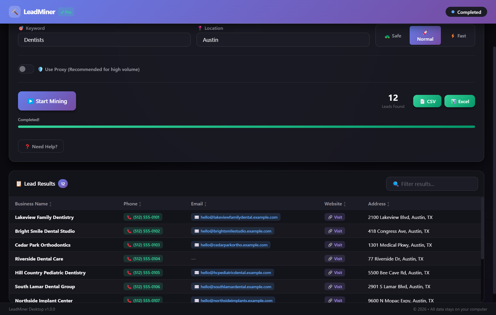
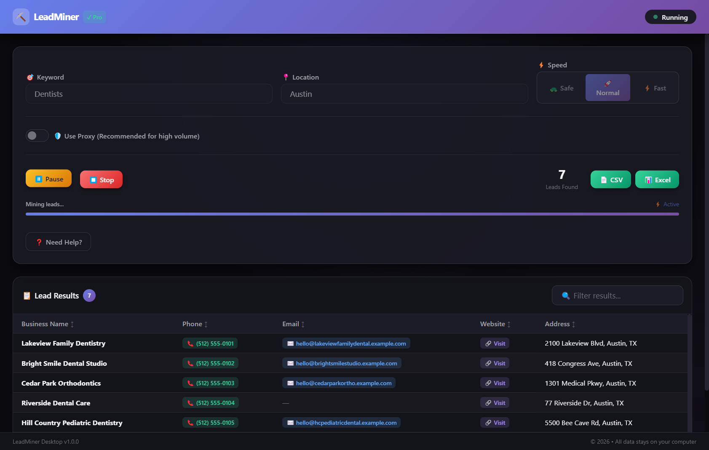
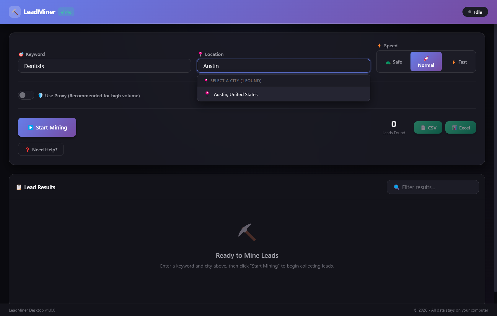
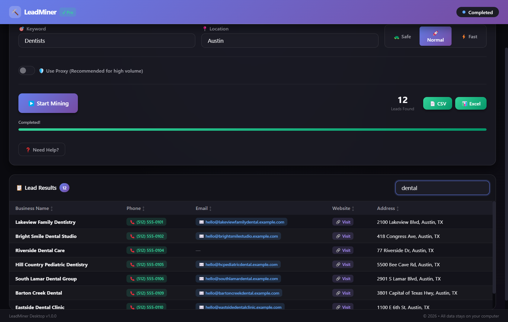
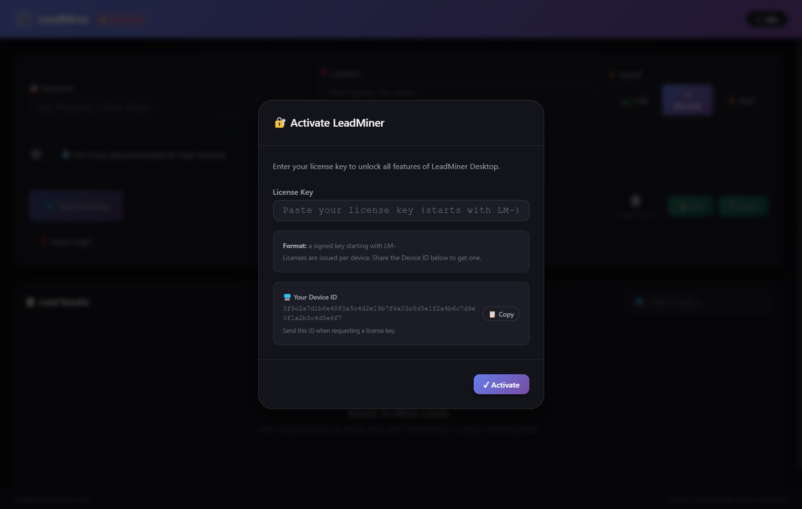

# LeadMiner

    

A local-first desktop app that builds lead lists of local businesses. Enter a keyword and a city ("dentists in Austin"); LeadMiner drives a real browser through public map listings, collects each business's name, phone, website and address, scans their websites for a public contact email, removes duplicates and exports a clean CSV or Excel file.

Everything runs on the user's machine. There are no accounts, servers or cloud dashboards.

> Use responsibly: only collect publicly available information and respect the terms of the sites you automate and the anti-spam laws where you do outreach.

## Screenshots

**Results:** businesses found for "Dentists in Austin", with phone, email, website and address.



| Mining in progress | City search |
|---|---|
|  |  |
| **Filtering results** | **License activation** |
|  |  |

Screenshots were taken in test mode with fictional sample data (`TEST_MODE=true MOCK_DATA=demo`). No real site was scraped.

## Features

- Keyword + city search with a live results table
- Business name, phone, website and address extraction
- Website crawl (homepage, then contact/about pages) for public email addresses
- Deduplication by phone number and domain
- Speed presets (slow / normal / fast) with adaptive delays
- Optional user-supplied proxy rotation
- Pause, resume and stop; sessions and results saved in SQLite
- CSV and Excel export
- Native Rust module for the job queue, rate limiting and audit logging
- RSA-signed, hardware-bound license keys verified in Rust

## Architecture

```
Electron
 ├── Renderer: React 19 + Vite (search form, live table, export)
 ├── Preload: typed, context-isolated IPC bridge
 ├── Main process (Node.js)
 │    ├── scraping/    Playwright browser manager, navigator, email extractor, proxies, speed control
 │    ├── processing/  normalisation and deduplication
 │    ├── storage/     SQLite via better-sqlite3
 │    └── export/      CSV and Excel writers
 └── Native module (Rust, napi-rs)
      ├── job queue and job manager
      ├── rate limiter
      ├── audit logger
      └── license validator (RSA-2048, PKCS#1 v1.5, SHA-256)
```

## Getting started

**Requirements:** Node.js 20+, Rust (stable) for the native module, and Playwright's Chromium.

```bash
npm install
npx playwright install chromium
npm run build:native     # compiles the Rust module with napi-rs
npm run dev              # Vite renderer + Electron main process
```

#_Developed December 2025 – March 2026. Imported from a private repository; the earlier commit history was left out because it contained unrelated business documents._

## License keys for local testing

Scraping is gated behind a signed license. To test locally, create your own key pair, then generate a license for your machine's hardware ID (shown in the app's activation screen):

```bash
openssl genrsa -out native/keys/private_key.pem 2048
openssl rsa -in native/keys/private_key.pem -pubout -out native/keys/public_key.pem
npm run build:native
node tools/generate-license.js --hardware-id <your-hardware-id> --lifetime
```

`private_key.pem` is git-ignored. Never commit it.

To exercise the UI without touching a real site, start the app with `TEST_MODE=true` to use the built-in mock scraper. Add `MOCK_DATA=demo` for a realistic set of fictional businesses.

## Testing

```bash
npm test                 # Jest unit tests
npm run build            # the Playwright specs run against the built app
npm run test:e2e         # Playwright end-to-end and performance specs
cd native && cargo test  # Rust native module tests
```

The end-to-end specs launch the app with a throwaway profile and issue themselves a license, so they need the local key pair described above. Without `native/keys/private_key.pem` they are skipped.

## Packaging

```bash
npm run build
npm run dist             # electron-builder: NSIS installer on Windows, DMG on macOS
```

See [docs/DEPLOYMENT_GUIDE.md](docs/DEPLOYMENT_GUIDE.md) for code signing and release steps.

## License

MIT. See [LICENSE](LICENSE).
